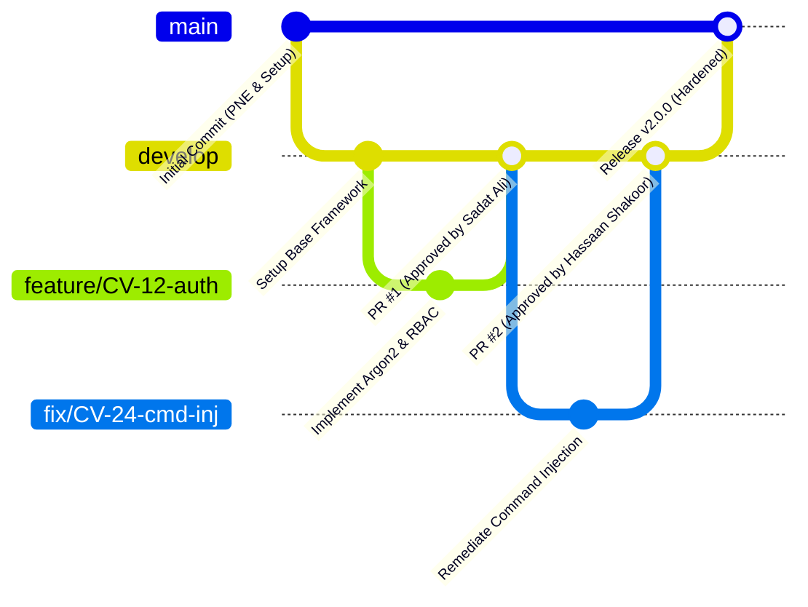

# Contributing to CloudVault DevSecOps Engineering Sprint

Thank you for contributing to the **CloudVault** project for CYC386 (Secure Software Design and Development). To maintain high-assurance security, code quality, and verifiable traceability, all team members must adhere to this workflow.

---

## 1. Team Roles & Responsibilities

| Member Name | Student ID | Primary Sprint Role |
|:---|:---:|:---|
| **Muhammad Tallat** | `FA23-BCT-029` | Lead Architect & Core Security Engineer (Auth, IDOR & Access Control) |
| **Sadat Ali** | `FA23-BCT-034` | AppSec & Threat Modeling Engineer (Native C Memory Safety & CSRF/Clickjacking) |
| **Hassaan Shakoor** | `FA23-BCT-054` | DevSecOps & QA Automation Engineer (CI/CD, SAST/DAST Gates & Command Injection) |

---

## 2. Git Branching Strategy & Workflow

This project adheres to an industry-standard **GitFlow / Trunk-based hybrid** model with strict branch protections:

1. **`main` Branch (Protected):**
   * Direct commits and pushes are strictly **prohibited**.
   * Only merges via Pull Request (PR) with at least **one approved peer review**.
   * All CI/CD pipeline checks (build, test, SAST, secret scan) must pass before merging.
2. **`develop` Branch (Integration):**
   * Staging branch for integrated feature verification.
3. **`feature/<JIRA-KEY>-<description>` Branches:**
   * Used for adding new features (e.g., `feature/CV-12-object-level-auth`).
4. **`fix/<JIRA-KEY>-<description>` Branches:**
   * Used for vulnerability remediation (e.g., `fix/CV-24-prevent-command-injection`).

---

## 3. Pull Request (PR) Requirements & Traceability

Every PR must satisfy:
1. **Traceability:** Link explicitly to a **Jira Issue** (`CV-XX`) and **Threat Model STRIDE ID** (`T-XX`).
2. **Peer Review:** Mandatory sign-off by at least one other team member.
3. **Commit Messages:** Follow the Conventional Commits format:
   * `feat(auth): CV-12 implement object-level authorization for document retrieval`
   * `fix(parser): CV-18 replace unbounded strcpy with snprintf and stack canaries`
   * `test(security): CV-22 add automated CSRF token validation tests`
   * `ci(gates): CV-30 enforce fail-on-critical policy in GitHub Actions`
4. **Zero Regressions:** Pass local test suites (`pytest tests/`) and SAST scans (`bandit -r app/`) with 0 High/Critical findings.

---

## 4. Secure Coding Checklist

Before submitting code for review:
* [ ] **Memory Safety (C/C++):** No usage of unsafe APIs (`strcpy`, `strcat`, `sprintf`, `gets`). All buffer sizes bounded and checked.
* [ ] **Process Execution:** No shell interpretation (`shell=True`, `system()`, backticks). Pass arguments as sanitized lists.
* [ ] **Authorization:** Verify tenancy and ownership on *every* object lookup (`owner_id == session_user_id`).
* [ ] **State Changes:** Validate anti-CSRF token on every `POST`/`PUT`/`DELETE` request.
* [ ] **Framing Defense:** Validate `X-Frame-Options: DENY` and `Content-Security-Policy: frame-ancestors 'none'` headers.
* [ ] **Input Sanitization:** Validate all incoming parameters against strict whitelist regex patterns.
