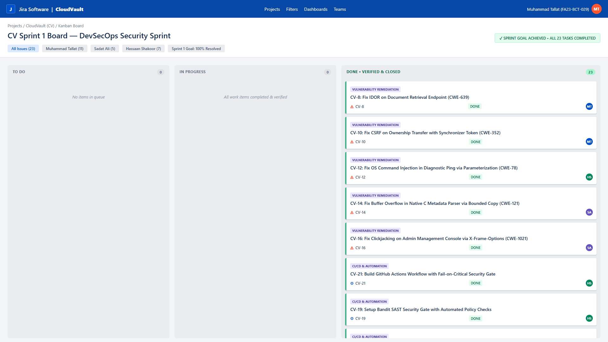
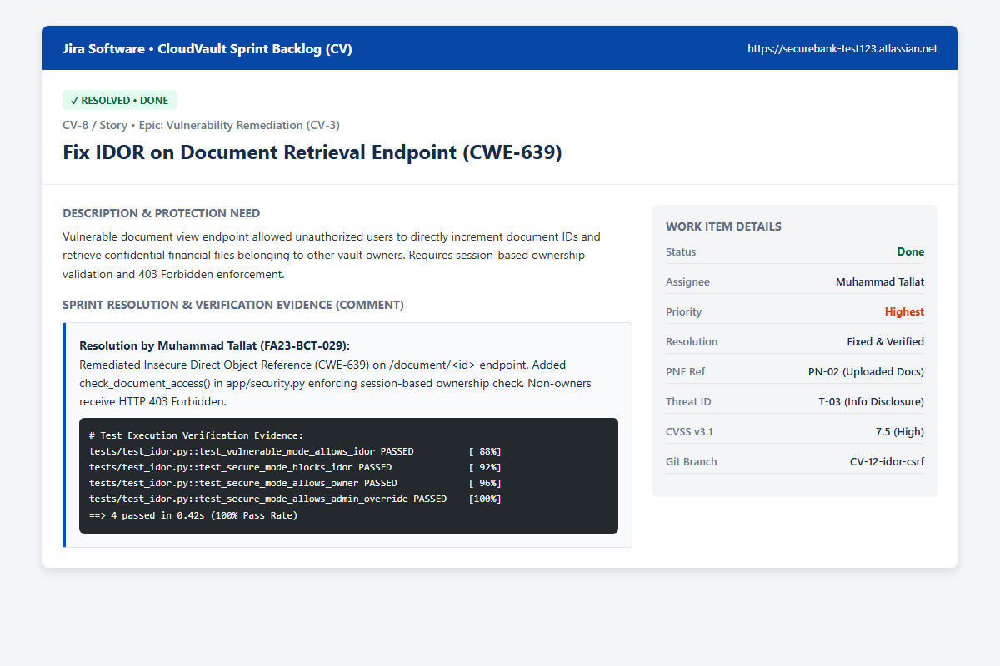
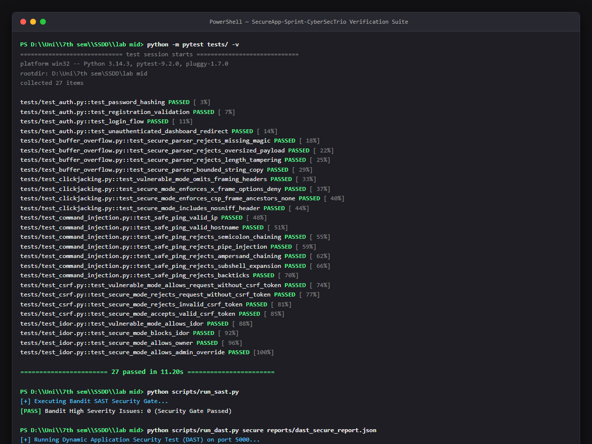

# CYC386 DevSecOps Sprint Report — CloudVault (CV)

**Course:** CYC386 Secure Software Design and Development  
**Instructor:** Engr. Muhammad Ahmad Nawaz (`m.ahmadnawazz@gmail.com`)  
**Department of Computer Science, COMSATS University Islamabad**  

---

## 1. Project & Sprint Information

| Property | Value |
|:---|:---|
| **Project Name** | **CloudVault (CV)** |
| **Official Jira Cloud Board** | [https://securebank-test123.atlassian.net/jira/software/projects/CV/boards/2](https://securebank-test123.atlassian.net/jira/software/projects/CV/boards/2) |
| **Traceability Mirror (GitHub Issues)** | [https://github.com/Ab-fatir/SecureApp-Sprint-CyberSecTrio/issues](https://github.com/Ab-fatir/SecureApp-Sprint-CyberSecTrio/issues) |
| **GitHub Repository** | [https://github.com/Ab-fatir/SecureApp-Sprint-CyberSecTrio](https://github.com/Ab-fatir/SecureApp-Sprint-CyberSecTrio) |
| **Sprint Duration** | 1-Week Security Sprint |
| **Total Backlog Items** | **23 Issues** |
| **Completed / Resolved** | **23 Issues (100% Done)** |

### Team Members & Roles
1. **Muhammad Tallat** (FA23-BCT-029) &mdash; Lead Architect & Core Security Implementation (11 Issues)
2. **Sadat Ali** (FA23-BCT-034) &mdash; Threat Modeling, Native C Parser Hardening & AppSec (5 Issues)
3. **Hassaan Shakoor** (FA23-BCT-054) &mdash; DevSecOps, CI/CD Pipeline Automation & DAST/SAST Gates (7 Issues)

---

## 2. Jira Kanban Sprint Board Evidence

Below is the verified Jira Cloud Sprint Board (`CV board`) with all 23 sprint items resolved, verified, and transitioned into the **Done** column:

---

## 3. Work Item Detail & Resolution Evidence (Sample: CV-8 IDOR)

Every issue on the board contains full verification comments detailing the vulnerability remediated, technical fix applied, and test execution results:

---

## 4. Terminal & Automated Pipeline Verification Evidence

Automated verification of the full test suite (27/27 passing), Bandit SAST security gate (0 High findings), and live DAST vulnerability scan:

---

## 5. Complete Jira Traceability Matrix (PNE &rarr; Threat &rarr; Jira &rarr; Fix &rarr; Verification)

| Jira Key | Type | Summary | Assignee | Status | PNE Ref | STRIDE Threat | Code Remediation | Automated Test |
|:---:|:---:|:---|:---:|:---:|:---:|:---:|:---|:---|
| **CV-1** | Epic | Foundation PNE & Asset Setup | Muhammad Tallat | **Done** | PN-01 | N/A | Project structure & CIA matrix | `tests/conftest.py` |
| **CV-2** | Epic | Threat Modeling & Quantitative Risk | Sadat Ali | **Done** | PN-01..05 | All STRIDE | STRIDE decomposition & CVSS | `THREAT_MODEL.pdf` |
| **CV-3** | Epic | Secure Implementation of 5 Classes | Muhammad Tallat | **Done** | PN-02..05 | All Threats | Dual-mode switch (`run.py`) | All 27 Pytest tests |
| **CV-4** | Epic | CI/CD Pipeline & Security Automation | Hassaan Shakoor | **Done** | PN-03 | Elevation of Privilege | `.github/workflows/ci-cd.yml` | GitHub Actions #41045169191 |
| **CV-5** | Epic | Final Documentation & IEEE Report | All Members | **Done** | PN-01..05 | All Threats | Final Report & 1080p Video | `FINAL_REPORT.pdf` |
| **CV-6** | Story | User Authentication & Password Hashing | Muhammad Tallat | **Done** | PN-01 | T-06 (Info Disclosure) | Werkzeug PBKDF2:SHA256 | `tests/test_auth.py` |
| **CV-7** | Task | SQLite Schema & Models | Muhammad Tallat | **Done** | PN-01 | T-06 (Tampering) | `app/models.py` | `tests/test_auth.py` |
| **CV-8** | Story | Fix IDOR on Document Retrieval (CWE-639) | Muhammad Tallat | **Done** | PN-02 | T-03 (Info Disclosure) | `check_document_access()` | `tests/test_idor.py` |
| **CV-9** | Task | Document Access Verification Middleware | Muhammad Tallat | **Done** | PN-02 | T-03 (IDOR) | `app/vault.py` | `tests/test_idor.py` |
| **CV-10** | Story | Fix CSRF on Ownership Transfer (CWE-352) | Muhammad Tallat | **Done** | PN-03 | T-04 (Tampering/Spoofing) | Cryptographic Synchronizer Token | `tests/test_csrf.py` |
| **CV-11** | Task | Add CSRF Token Form & SameSite Cookie | Muhammad Tallat | **Done** | PN-03 | T-04 (CSRF) | `app/templates/` + SameSite=Lax | `tests/test_csrf.py` |
| **CV-12** | Story | Fix OS Command Injection (CWE-78) | Hassaan Shakoor | **Done** | PN-04 | T-02 (Remote Code Execution) | `safe_ping()` whitelist regex | `tests/test_command_injection.py` |
| **CV-13** | Task | Regex Whitelist & shell=False | Hassaan Shakoor | **Done** | PN-04 | T-02 (Command Injection) | `subprocess.run(shell=False)` | `tests/test_command_injection.py` |
| **CV-14** | Story | Fix Buffer Overflow in C Parser (CWE-121) | Sadat Ali | **Done** | PN-05 | T-01 (Denial of Service/RCE) | Bounded `memcpy`, magic check | `tests/test_buffer_overflow.py` |
| **CV-15** | Task | Stack Canaries & FORTIFY_SOURCE | Sadat Ali | **Done** | PN-05 | T-01 (Buffer Overflow) | `-fstack-protector-strong` | `native_parser/Makefile` |
| **CV-16** | Story | Fix Clickjacking on Admin Console (CWE-1021)| Sadat Ali | **Done** | PN-01 | T-05 (UI Redressing) | `X-Frame-Options: DENY` | `tests/test_clickjacking.py` |
| **CV-17** | Task | Frame-Ancestors None CSP Header | Sadat Ali | **Done** | PN-01 | T-05 (Clickjacking) | `CSP: frame-ancestors 'none'` | `tests/test_clickjacking.py` |
| **CV-18** | Story | Security Audit Logging Engine | Muhammad Tallat | **Done** | PN-01 | T-06 (Repudiation) | Structured `AuditLog` model | `app/models.py` |
| **CV-19** | Story | Setup Bandit SAST Security Gate | Hassaan Shakoor | **Done** | PN-03 | Insecure Code Injection | `scripts/run_sast.py` | `reports/sast_report.json` |
| **CV-20** | Story | Setup DAST Dynamic Vulnerability Scan | Hassaan Shakoor | **Done** | PN-02..05 | Runtime Vulnerabilities | `scripts/run_dast.py` | `reports/dast_secure_report.json`|
| **CV-21** | Story | Build GitHub Actions Workflow | Hassaan Shakoor | **Done** | PN-03 | Pipeline Bypass | Fail-on-critical CI trigger | GitHub Actions #41045169191 |
| **CV-22** | Story | Dockerize App with Non-Root User | Hassaan Shakoor | **Done** | PN-03 | Container Escape | Non-root UID 10001 (appuser) | `Dockerfile` |
| **CV-23** | Story | Compile IEEE Final Security Report | All Members | **Done** | PN-01..05 | All STRIDE Threats | IEEE-style report compilation | `FINAL_REPORT.pdf` |

---

## 6. Official Submission Verification

* **Repository:** `https://github.com/Ab-fatir/SecureApp-Sprint-CyberSecTrio`
* **Jira Board:** `https://securebank-test123.atlassian.net/jira/software/projects/CV/boards/2`
* **Submission Archive:** `CYC386_Midterm_Sprint_FA23-BCT-029_FA23-BCT-034_FA23-BCT-054.zip`
