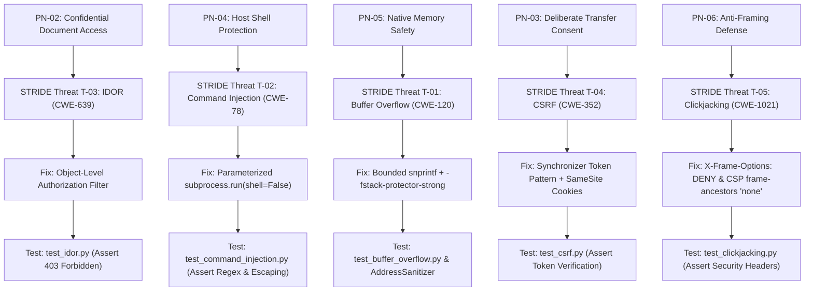

# Protection Needs Elicitation (PNE) & CIA Triad Mapping Report
**Project:** CloudVault — Enterprise Secure Document & DevOps Artifact Collaboration Hub  
**Course:** CYC386 — Secure Software Design and Development (Fall 2026)  
**Instructor:** Engr. Muhammad Ahmad Nawaz  
**Sprint:** 1-Week DevSecOps Security Engineering Sprint  
**Team Members:**  
1. **Muhammad Tallat** (FA23-BCT-029) — Lead Architect & Secure Core Engineer  
2. **Sadat Ali** (FA23-BCT-034) — Threat Modeling & AppSec Engineer  
3. **Hassaan Shakoor** (FA23-BCT-054) — DevSecOps & QA Automation Engineer  

---

## 1. Executive Summary
In alignment with **CDF Unit 2 (Protection Needs Elicitation)**, this document establishes the formal asset inventory, stakeholder perspectives, security boundary definitions, and explicit mapping to the **CIA Triad (Confidentiality, Integrity, Availability)** for the CloudVault platform. Every elicited protection need serves as the foundational justification for subsequent STRIDE threat modeling, defensive engineering, and automated verification tests.

---

## 2. Comprehensive Asset Inventory

Assets within CloudVault are classified into four distinct operational domains:

### 2.1 Data Assets
* **DA-01: User Credentials & Authentication Tokens:** Passwords, session cookies, bearer tokens, and cryptographic keys.
* **DA-02: Confidential Vault Documents:** Encrypted proprietary files, system blueprints, sensitive financial audits, and source archives.
* **DA-03: Document Metadata:** Author identities, creation timestamps, classification flags, and file sizes.
* **DA-04: Security Audit & Traceability Logs:** Immutable records of authentication attempts, document access, ownership transfers, and administrative lockdowns.

### 2.2 Process & Functional Assets
* **PA-01: User Authentication & Session Lifecycle:** Credential verification, session generation, and role derivation.
* **PA-02: Native Binary Header Parser:** In-process C module parsing binary document headers (`CVLT`).
* **PA-03: DevOps Network Health Diagnostic Engine:** Execution of node connectivity diagnostics and ping routines.
* **PA-04: Document Access & Authorization Engine:** Tenant isolation and object-level authorization verification.
* **PA-05: State-Changing Ownership Transfer:** Cryptographic transaction transferring asset ownership between tenants.

### 2.3 System & Component Assets
* **CA-01: Web Application Container:** Python/Flask application runtime executing WSGI requests.
* **CA-02: Relational Database Storage:** SQLite / PostgreSQL persistent database storage.
* **CA-03: Native Shared Library (`libparser_secure.so`):** Compiled binary shared object executing native C operations.
* **CA-04: Host Operating System & Execution Environment:** Linux/POSIX or Windows kernel, filesystem permissions, and process namespaces.

### 2.4 External Entities
* **EE-01: Standard Authenticated User (Tenant):** Operates personal vault documents with restricted non-admin privileges.
* **EE-02: System Administrator:** Possesses superuser capabilities to audit logs, manage tenants, and trigger emergency lockdowns.
* **EE-03: System Operator / DevOps Engineer:** Manages deployment pipelines, monitoring systems, and container configurations.
* **EE-04: Network Adversary / Malicious Actor:** External or internal attacker attempting unauthorized access, injection, framing, or denial of service.

---

## 3. Stakeholder Perspectives & Protection Needs Elicitation

| Stakeholder ID | Stakeholder Role | Perspective & Core Concerns | Elicited Protection Needs |
|:---:|:---|:---|:---|
| **ST-01** | Standard User | Privacy of confidential documents; assurance that other users cannot view or tamper with personal files. | Strict cross-tenant isolation; prevention of unauthorized reading (IDOR) and unauthorized transfers (CSRF). |
| **ST-02** | System Administrator | Platform integrity; defense against social engineering and clickjacking; forensic auditability. | Protection of administrative consoles against UI framing; tamper-proof audit trails; verified authorization on all management routes. |
| **ST-03** | DevOps / Operator | Service availability; process stability; isolation of external binaries and diagnostics. | Prevention of arbitrary system command execution via diagnostics; memory safety to avoid process crashes. |
| **ST-04** | Security Auditor | Full traceability from threat to fix; compliance with OWASP Top 10, CWE Top 25, and SEI CERT C standards. | Verifiable automated testing; SAST/DAST gating in CI/CD; fail-on-critical build policies. |

---

## 4. Explicit CIA Triad Mapping & Requirement Derivation

Every elicited protection need maps directly to one or more pillars of the **CIA Triad** (CDF Unit 2 requirement):

| Protection Need ID | Asset Ref | Description of Protection Need | CIA Mapping | Derived Measurable Security Requirement | Jira Issue Ref |
|:---:|:---:|:---|:---:|:---|:---:|
| **PN-01** | DA-01 | User authentication tokens and credentials must be shielded from unauthorized extraction or session hijacking. | **Confidentiality** | **SR-01:** Passwords must be hashed using salted slow hashes (Argon2 / PBKDF2). Session cookies must carry `HttpOnly`, `SameSite=Strict`, and `Secure` attributes. | `CV-10` |
| **PN-02** | DA-02 | Confidential document content must only be accessible to authorized owners and designated administrators. | **Confidentiality** | **SR-02:** Every document retrieval endpoint (`/documents/<id>`) must enforce object-level authorization (`doc.owner_id == session.user_id`). Reject violations with HTTP 403. | `CV-12` |
| **PN-03** | PA-05 | Document ownership and rights transfers must only execute with explicit, deliberate tenant consent. | **Integrity** | **SR-03:** All state-changing endpoints (`POST`, `PUT`, `DELETE`) must require a cryptographically unique Synchronizer CSRF Token. | `CV-14` |
| **PN-04** | CA-01, CA-04 | The host OS shell and underlying execution environment must remain inaccessible to user-controlled inputs. | **Integrity & Availability** | **SR-04:** DevOps diagnostic routines must prohibit shell interpretation (`shell=False`) and enforce strict regex whitelisting (`^[a-zA-Z0-9.-]+$`) on all hostname inputs. | `CV-16` |
| **PN-05** | PA-02, CA-03 | Native binary parsing must never corrupt memory buffers, overwrite control flow, or crash the daemon. | **Integrity & Availability** | **SR-05:** C native parser must validate binary magic bytes (`CVLT`), enforce input length bounds, replace `strcpy` with safe bounded APIs (`snprintf`), and compile with `-fstack-protector-strong`. | `CV-18` |
| **PN-06** | ST-02, CA-01 | Sensitive administrative panels must not be framed inside malicious third-party websites or hidden overlays. | **Integrity & Confidentiality** | **SR-06:** All HTTP responses must include `X-Frame-Options: DENY` and Content-Security-Policy directive `frame-ancestors 'none'`. | `CV-20` |
| **PN-07** | DA-04 | Security audit logs must record all authentication attempts, privilege elevations, and access denials. | **Integrity & Repudiation** | **SR-07:** Audit logs must record timestamp, actor ID, action type, IP address, and details into persistent database storage. | `CV-22` |
| **PN-08** | CA-01, CA-02 | The platform must remain resilient against denial-of-service and memory starvation attacks. | **Availability** | **SR-08:** Binary header parsing payload size is hard-capped at 4096 bytes. Subprocess diagnostics enforce a strict 5-second execution timeout. | `CV-24` |
| **PN-09** | CA-01 | High-risk and critical vulnerabilities must be detected and blocked automatically before reaching production. | **Integrity & Availability** | **SR-09:** CI/CD pipeline must execute SAST (Bandit) and DAST gates, terminating with a non-zero exit code if any Critical or High vulnerability is found. | `CV-26` |

---

## 5. Traceability Matrix: PNE $\rightarrow$ Threat $\rightarrow$ Fix $\rightarrow$ Test

---

## 6. Sign-off & Verification Statement
This Protection Needs Elicitation baseline has been verified against the CYC386 Course Description Form (CDF Unit 2) and approved by the engineering sprint team:
* **Muhammad Tallat** (Lead Architect & Core Engineer) — *Signed: 2026-10-30*
* **Sadat Ali** (AppSec & Threat Modeling Engineer) — *Signed: 2026-10-30*
* **Hassaan Shakoor** (DevSecOps & Testing Engineer) — *Signed: 2026-10-30*
