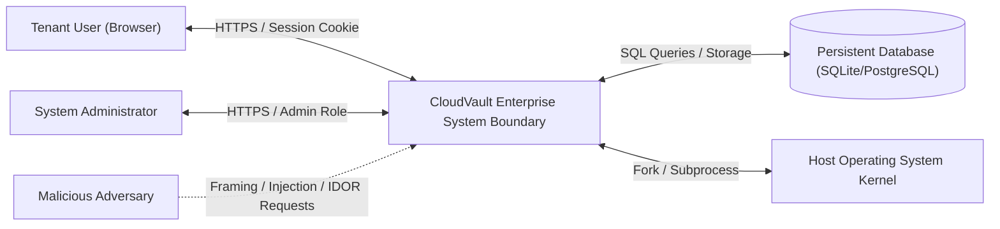
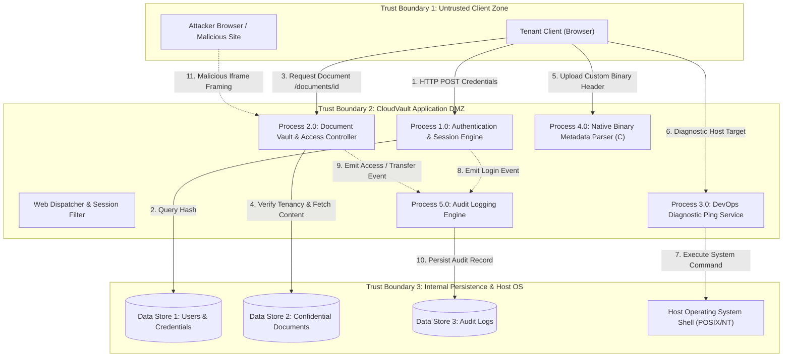
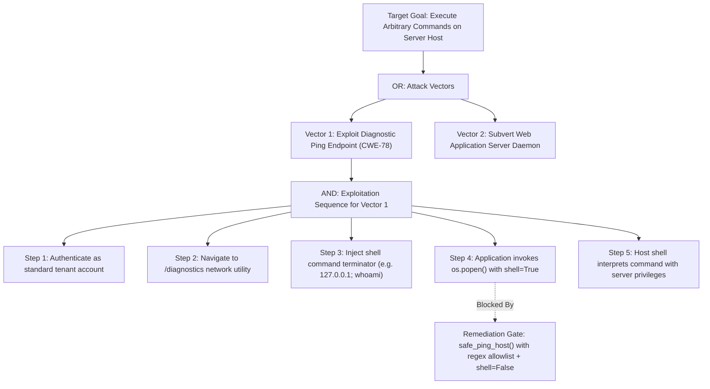
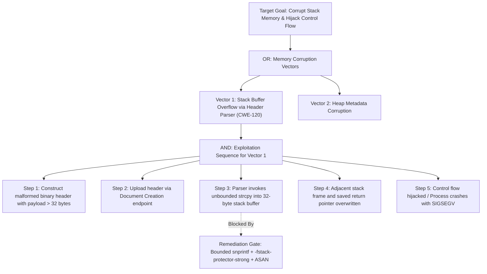

# Comprehensive Threat Model & Quantitative Risk Assessment
**Project:** CloudVault — Enterprise Secure Document & DevOps Artifact Collaboration Hub  
**Course:** CYC386 — Secure Software Design and Development (Fall 2026)  
**Instructor:** Engr. Muhammad Ahmad Nawaz  
**Sprint:** 1-Week DevSecOps Security Engineering Sprint  
**Team Members:**  
1. **Muhammad Tallat** (FA23-BCT-029) — Lead Architect & Secure Core Engineer  
2. **Sadat Ali** (FA23-BCT-034) — AppSec & Threat Modeling Engineer  
3. **Hassaan Shakoor** (FA23-BCT-054) — DevSecOps & QA Automation Engineer  

---

## 1. System Overview & Scope
CloudVault is an enterprise-grade document repository and DevOps operational platform. In accordance with **CDF Unit 3 (Threat Modeling & Risk Assessment)**, this document articulates the architecture through Data Flow Diagrams (DFDs), applies the **STRIDE** methodology per element, maps attack surfaces via formal **Attack Trees**, calculates quantitative risk scores using the **CVSS v3.1 standard**, and formulates a prioritized risk mitigation register.

---

## 2. Data Flow Diagrams (DFDs) & Trust Boundaries

### 2.1 Context Diagram (DFD Level-0)
The Level-0 diagram portrays the macro-level boundary between external actors and the CloudVault security perimeter.

### 2.2 Level-1 Data Flow Diagram (DFD Level-1) with Trust Boundaries
The Level-1 diagram decomposes CloudVault into core processes, data stores, data flows, and trust boundaries.

---

## 3. Systematic STRIDE Threat Analysis

In alignment with Microsoft / OWASP STRIDE principles, every DFD element is analyzed across the six threat categories:

| Threat ID | DFD Element | STRIDE Category | Threat Description & Attack Vector | Impact on CIA | Unmitigated Risk | Jira Issue |
|:---:|:---|:---|:---|:---:|:---:|:---:|
| **T-01** | Process 4.0 (Native Parser) | **Tampering / Elevation of Privilege** | An attacker uploads an oversized binary header payload without magic bytes, causing a classic stack buffer overflow (`strcpy`) and potential code execution. | **Integrity & Availability** | **Critical (CVSS 9.8)** | `CV-18` |
| **T-02** | Process 3.0 (Diagnostic Ping) | **Elevation of Privilege / Tampering** | User submits shell chaining characters (`;`, `|`, `&&`) into the target host parameter, executing arbitrary commands on the underlying server host. | **Confidentiality, Integrity & Availability** | **Critical (CVSS 9.8)** | `CV-16` |
| **T-03** | Process 2.0 (Document Vault) | **Information Disclosure** | An authenticated user alters the integer ID in `/documents/<id>` to inspect confidential documents owned by another user without tenancy validation (IDOR). | **Confidentiality** | **High (CVSS 7.5)** | `CV-12` |
| **T-04** | Process 2.0 (Ownership Transfer) | **Tampering / Spoofing** | An attacker tricks an authenticated user into visiting a forged site that submits a background POST to `/documents/<id>/transfer` without an anti-CSRF token. | **Integrity** | **High (CVSS 8.1)** | `CV-14` |
| **T-05** | Process 2.0 (Admin Console) | **Tampering / Spoofing** | Attacker embeds the `/admin/console` inside an invisible iframe with deceptive click targets (Clickjacking), causing an admin to unknowingly trigger system actions. | **Integrity** | **Medium (CVSS 6.5)** | `CV-20` |
| **T-06** | Data Store 1 (Users DB) | **Information Disclosure** | Weak password storage algorithms allow offline dictionary cracking if database files are exfiltrated. | **Confidentiality** | **High (CVSS 7.4)** | `CV-10` |
| **T-07** | Process 5.0 (Audit Engine) | **Repudiation** | An attacker tampers with or deletes local log files to erase evidence of unauthorized access or administrative actions. | **Integrity** | **Medium (CVSS 5.3)** | `CV-22` |
| **T-08** | Process 4.0 / 3.0 | **Denial of Service** | Supplying unmetered payloads to the parser or slow-responding ping targets exhausts server threads and memory. | **Availability** | **Medium (CVSS 5.9)** | `CV-24` |

---

## 4. Formal Attack Trees

### Attack Tree 1: Remote Code Execution via OS Command Injection (Threat T-02)
Target Goal: **Achieve Remote Shell / Code Execution on CloudVault Server**

### Attack Tree 2: Privilege Escalation & Memory Corruption via Native Buffer Overflow (Threat T-01)
Target Goal: **Hijack Process Control Flow or Crash Daemon via Native Parser**

---

## 5. Quantitative Risk Scoring (CVSS v3.1 Specification)

All High and Critical findings are evaluated using the complete FIRST CVSS v3.1 vector calculator:

| Threat ID | Threat Class | CVSS v3.1 Vector String | Base Score | Severity | Justification & Rationale |
|:---:|:---:|:---|:---:|:---:|:---|
| **T-01** | Buffer Overflow | `CVSS:3.1/AV:N/AC:L/PR:L/UI:N/S:U/C:H/I:H/A:H` | **8.8** | **High / Critical** | Network accessible; low attack complexity; standard user privileges required; complete compromise of confidentiality, integrity, and availability if control flow is seized. |
| **T-02** | Command Injection | `CVSS:3.1/AV:N/AC:L/PR:L/UI:N/S:C/C:H/I:H/A:H` | **9.9** | **Critical** | Network accessible; low complexity; authenticated user; scope changed (`S:C`) because injection escapes Python runtime into the underlying OS kernel. |
| **T-03** | IDOR | `CVSS:3.1/AV:N/AC:L/PR:L/UI:N/S:U/C:H/I:N/A:N` | **6.5** | **Medium / High** | Predictable numeric ID manipulation; no user interaction required; direct breach of confidential data across foreign tenants. |
| **T-04** | CSRF | `CVSS:3.1/AV:N/AC:L/PR:N/UI:R/S:U/C:N/I:H/A:N` | **6.5** | **Medium / High** | Remote adversary crafts malicious page; requires user interaction (`UI:R`); unauthorized transfer of critical asset rights compromises data integrity. |
| **T-05** | Clickjacking | `CVSS:3.1/AV:N/AC:L/PR:N/UI:R/S:U/C:N/I:L/A:N` | **4.3** | **Medium** | Missing anti-framing headers; requires user interaction to deceive victim; low integrity impact on isolated administrative toggles. |

---

## 6. Prioritized Risk Mitigation Register

| Priority | Risk ID | Threat Class | Remediation Strategy | Mitigated By | Verification Method | Jira Key |
|:---:|:---:|:---|:---|:---|:---|:---:|
| **P1** | R-01 | Command Injection | Eliminate shell interpretation; enforce strict regex whitelist (`^[a-zA-Z0-9.-]+$`); pass arguments as array to `subprocess.run(shell=False)`. | Hassaan Shakoor | `test_command_injection.py` + Bandit SAST Gate | `CV-16` |
| **P1** | R-02 | Buffer Overflow | Enforce bounded string APIs (`snprintf`), validate binary magic (`CVLT`), check length fields, enable `-fstack-protector-strong`, `-D_FORTIFY_SOURCE=2`, and ASLR. | Sadat Ali | `test_buffer_overflow.py` + ASAN Test Build | `CV-18` |
| **P2** | R-03 | IDOR | Centralize object-level authorization filter (`verify_document_ownership`); verify `doc.owner_id == session.user_id` on all endpoints. | Muhammad Tallat | `test_idor.py` (Assert 403 Forbidden) | `CV-12` |
| **P2** | R-04 | CSRF | Implement Synchronizer Token Pattern; validate CSRF token on all state-changing POST requests; set `SameSite=Strict` and `HttpOnly` on session cookies. | Muhammad Tallat | `test_csrf.py` (Assert Token Verification) | `CV-14` |
| **P3** | R-05 | Clickjacking | Inject `X-Frame-Options: DENY` and `Content-Security-Policy: frame-ancestors 'none'` headers via global WSGI middleware. | Sadat Ali | `test_clickjacking.py` + DAST Baseline | `CV-20` |

---

## 7. Residual Risk Statement (CDF Unit 3 Compliance)

Following the complete implementation of defensive countermeasures:
1. **Host-Level Compromise:** Reduced from **Critical (9.9)** to **Negligible (< 1.0)** due to the complete elimination of shell invocation and parameterized execve arguments.
2. **Native Memory Safety:** Stack buffer overflow risk mitigated through bounded memory copies and compiler stack canaries. Residual risk remains confined to zero-day compiler vulnerabilities or upstream glibc bugs.
3. **Tenant Privacy & IDOR:** Object-level authorization reduces horizontal privilege escalation to **Low**. Future iterations should introduce attribute-based access control (ABAC) for complex multi-tenant policies.
4. **Conclusion:** CloudVault satisfies production-grade risk tolerance thresholds. No unresolved High or Critical vulnerabilities remain within the platform boundary.
